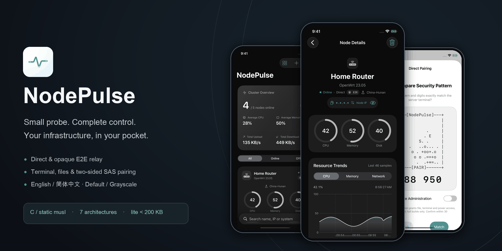
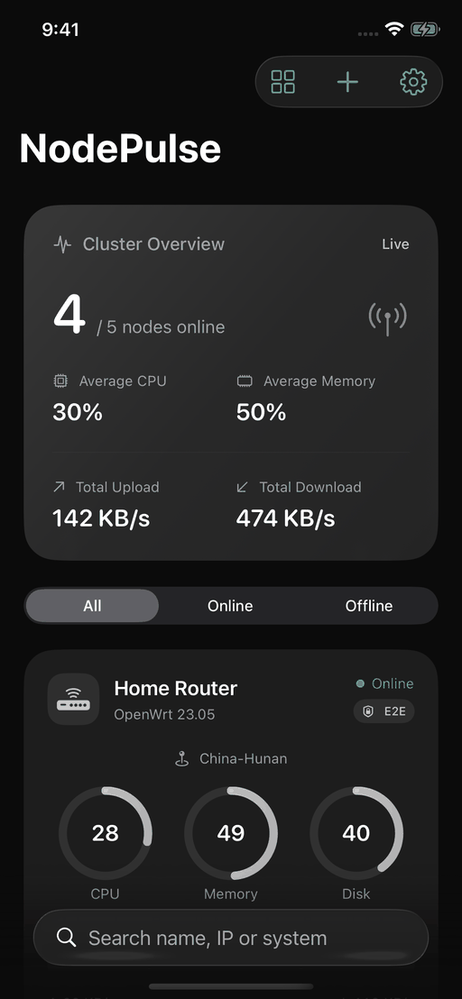
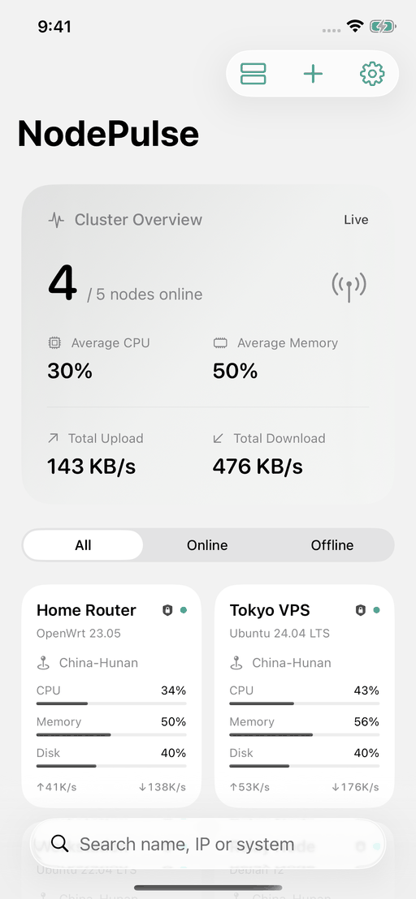
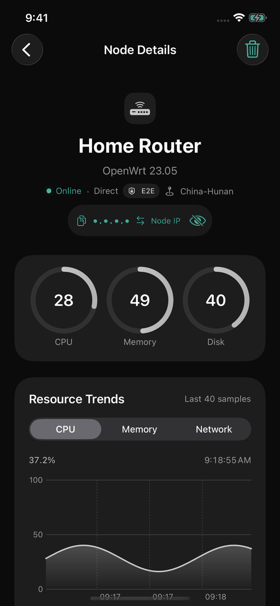
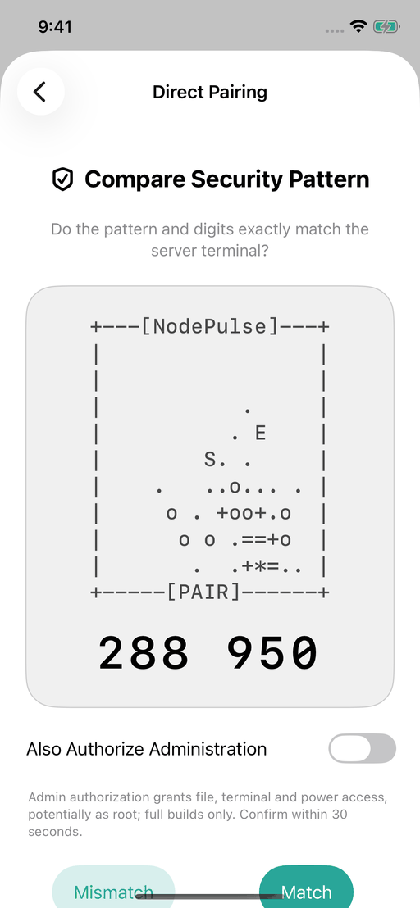
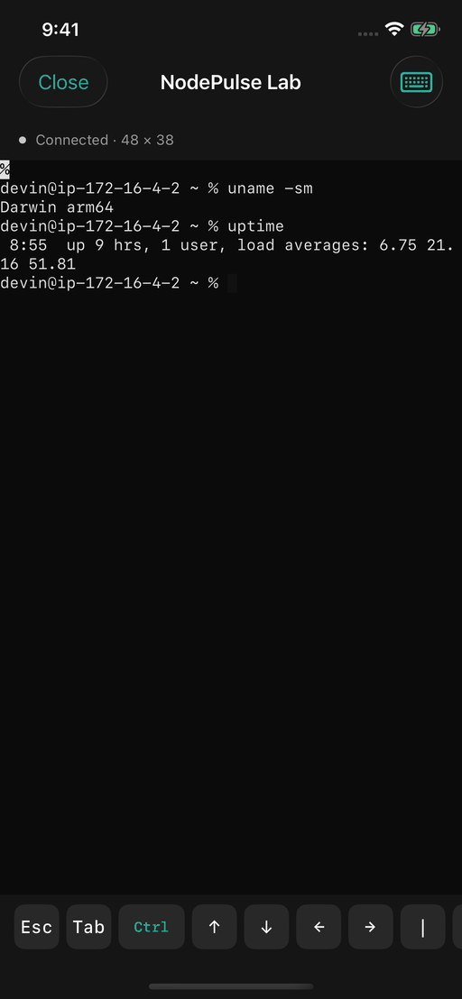
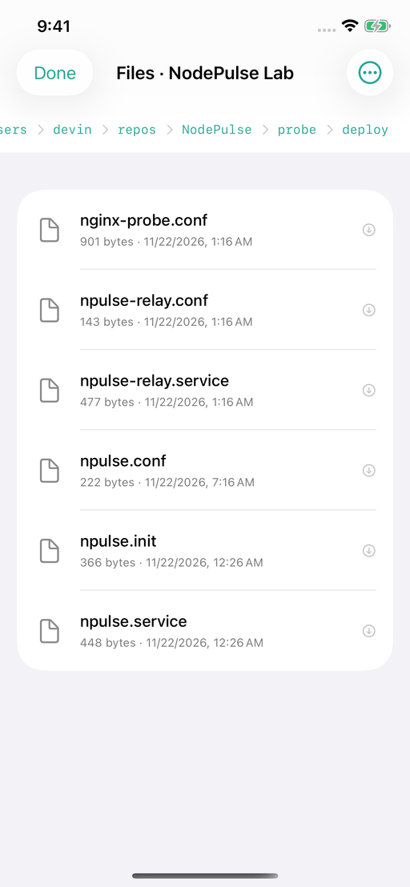
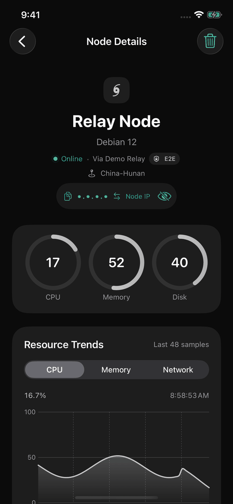
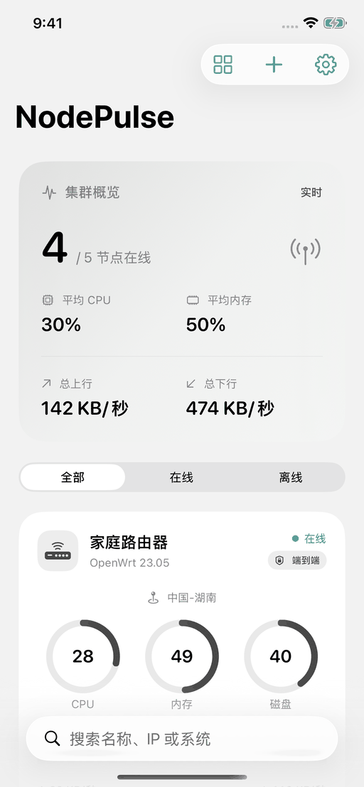
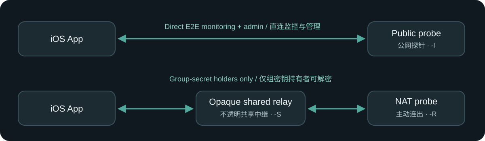

<div align="center">

[简体中文](README.md) · **English**


# NodePulse

**Small probe. Complete control.**

A tiny Linux / OpenWrt C probe, with an iOS monitoring and administration console in your pocket.

[](ios/)
[](ios/)
[](probe/)
[](LICENSE)
[](https://github.com/cestbon0309/NodePulse/releases/latest)

[Highlights](#features) · [Screenshots](#screenshots) · [Architecture](#architecture) · [Deploy](#deploy) · [Pair](#pairing) · [Install iOS](#ios) · [Build](#build) · [Security](#security)



</div>

<a id="features"></a>
## Small footprint. Full visibility.

|  Deploy lightly |  See clearly |  Act securely |
|---|---|---|
| **C / static musl**: seven Linux architectures; every release lite under 200,000 bytes | **Live trends**: CPU, memory, disk, network, temperature and online status | **Administration**: interactive terminal, files and power controls; separate public keys |
| **One process, multiple roles**: direct monitoring plus shared relay; systemd / OpenWrt procd | **Two layouts, two themes**: classic / compact, Default / Grayscale, light / dark | **Two-sided SAS**: direct, relay and QR-assisted pairing; scanning never bypasses confirmation |
| **NAT-friendly**: outbound-only publishers; relays never receive the group secret | **English / Chinese**: follows system language; persistent egress-IP location cache | **Privacy toggle**: hidden IPs always become `•.•.•.•`; copying retains the real address |

**Last 120 seconds**: full and lite retain one resource sample per second. The foreground app polls every second, fills history on reconnect/foreground, and otherwise fetches increments. Relays cache only encrypted history; older versions fall back to snapshots. [Protocol and memory limits](docs/history-protocol.md).

<a id="screenshots"></a>
## A closer look

| Classic dashboard · Grayscale | Compact dashboard |
|:---:|:---:|
|  |  |
| Node details · Grayscale | Two-sided SAS pairing |
|  |  |
| Terminal | Files |
|  |  |
| Shared-relay node | Grayscale · Light |
|  |  |

Dashboard / details use simulator demo data. Pairing, terminal and files use isolated localhost protocol fixtures, not production hosts. Sample locations do not identify real devices.

<a id="architecture"></a>
## Two paths. One console.



Use direct TCP for public hosts, or shared relay for NAT, home networks and routers. Only trusted group members and the app hold the group secret; relays forward opaque ciphertext. One process can serve `-l` and `-S`: administer that host directly and downstream nodes through an end-to-end relay pipe.

<a id="deploy"></a>
## Quick deployment

Run in a **root shell on Linux / OpenWrt**. These commands install the latest release; this page describes current source, with new features shipping in the next release.

```sh
curl -fsSL https://github.com/cestbon0309/NodePulse/releases/latest/download/install.sh | sh
# or
wget -qO- https://github.com/cestbon0309/NodePulse/releases/latest/download/install.sh | sh
```

The first question is `1 中文 / 2 English`, defaulting from `LC_ALL` / `LANG`. Then choose by network:

| Mode | Best for | Allow |
|---|---|---|
| **1 Direct** (recommended with public IP) | Public servers; optionally also a shared relay | Direct TCP, default 9000; relay port too if enabled |
| **2 HTTP + Nginx** | Existing domain, certificate and HTTPS proxy | Public 443; HTTP backend stays loopback-only |
| **3 Shared-relay publisher** | NAT / home / routers | Outbound TCP to relay; no inbound port |
| **4 Relay only** | Public host forwarding opaque ciphertext | Relay TCP port |

Mode 1 asks whether to also host a shared relay: default **no**. If enabled, its default port is the direct port + 1; ports must differ. Node names default to hostname (`--name` overrides). **full** is the default; choose `--lite` explicitly for size (no admin/live pipes; pairing downloads and verifies temporary full).

```sh
# After downloading install.sh: direct 9000 + shared relay 9001 in one process
sh install.sh --yes --lang en --mode 1 --public-ip auto --also-relay 9001
# NAT publisher: match the relay token and share a random secret within your group
NPULSE_TOKEN='replace-with-relay-token' NPULSE_GROUP_SECRET='replace-with-random-group-secret' \
  sh install.sh --yes --lang en --mode 3 --upstream relay.example:9001
```

The summary lists the build, config, ports, relay address/password and next steps. **It contains secrets: never publish real install logs.** Allow local firewall and cloud security-group ports; automatic firewall changes require explicit `--open-firewall`. Cloud external IPs need not exist on a local NIC: listening and advertised addresses are separate.

See the [installer reference](docs/installer.md) for all options, BusyBox prerequisites, lifecycle and consent. Legacy `upstream=` / `u=` configurations fail before modifying the running service, with shared-relay migration guidance.

<a id="pairing"></a>
## Pairing: scanning is only the start

1. Run `sh install.sh pair` on the server (stops/restores the service), or pair at installation's end.
2. In **Add Endpoint**, choose **Direct Pairing** for public nodes or **Relay Pairing** for NAT; provide relay address, token and one-time code. Alternatively scan the terminal QR or paste its `nodepulse://pair` link.
3. **Compare the pattern and six-digit SAS on BOTH devices.** Only if identical, enter `y` on the server and tap **Match** on the phone. Cancel any mismatch. QR and pre-shared parameters never replace this check.
4. For administration, enable phone-side admin authorization and **separately confirm root authorization on the server**. Otherwise only monitoring is enabled. Use `--admin-via-pair`, or provision an existing allowlist with `--admin-keys`.

QR / links contain sensitive temporary parameters: do not share them. Relay pairing uses TCP. See the [pairing protocol](docs/pairing-protocol.md) and [administration protocol](docs/admin-protocol.md).

<a id="ios"></a>
## Install the iOS app

Download `NodePulse-<tag>.ipa` from the [latest release](https://github.com/cestbon0309/NodePulse/releases/latest) and verify against `SHA256SUMS`. This is an **unsigned arm64 device IPA**, not an App Store package. Re-sign using AltStore / Sideloadly or your own Xcode developer identity. Requires iOS 17+; enable Developer Mode and trust your signing identity when prompted. Signing lifetime depends on your Apple developer account.

<a id="build"></a>
## Build from source

```sh
cd probe
make CC=musl-gcc       # native Linux static build
./build.sh            # Zig: seven architectures, full + lite → dist/
make host-test        # macOS / Linux protocol fixture, not a macOS monitor
cd ../ios
xcodegen generate
open NodePulse.xcodeproj
./tools/build-unsigned-ipa.sh dev  # unsigned device Release IPA
```

Requires C / musl; Zig for cross-builds. iOS requires macOS, Xcode and XcodeGen. Targets: `x86_64`, `i386`, `aarch64`, `armv7` (hard float), `armv7-soft`, `mips`, `mipsel` (check byte order / ABI). Select a simulator in Xcode for unit tests; `ios/tools/check-localization.py` audits bilingual coverage. Probe tests: `python3 probe/tools/test-probe.py probe/npulse-host` (Python cryptography required).

<a id="security"></a>
## Security model and boundaries

- **Monitoring by default**: administration needs a separate Ed25519 allowlist and inherits probe-user privileges. Installer-enabled admin runs as root with full host control; ordinary systemd uses DynamicUser, procd uses root.
- **Direct / shared TCP**: ChaCha20-Poly1305; administration uses ephemeral X25519 and independent directional keys. Monitoring/group protocols have no forward secrecy or password stretching: use long random secrets.
- **Relays are untrusted**: routing metadata, sizes and timing are visible; relays can deny service or replay. Clients validate signatures, slots and snapshot time. Group members trust each other; a token is not a group secret.
- **HTTPS endpoints**: TLS terminates at Nginx; these omit the TCP E2E badge and cannot administer. Never expose the HTTP backend publicly. Shared-group payloads retain independent end-to-end encryption.
- **Location is not authentication**: full probes discover egress IP through tiny plain-HTTP requests, configurable or disableable. The app queries a third party over HTTPS and caches per IP/language; that service sees queried IPs. Failure does not interrupt monitoring; hiding IPs does not hide location. See [egress discovery and location](docs/egress-location.md).

## License

**GPL-2.0-only**: [LICENSE](LICENSE). Monocypher (BSD-2-Clause / CC0), Nayuki QR (MIT) and SwiftTerm (MIT) retain their notices; see [third-party licenses](ios/NodePulse/ThirdPartyNotices.txt), also in app Settings.
