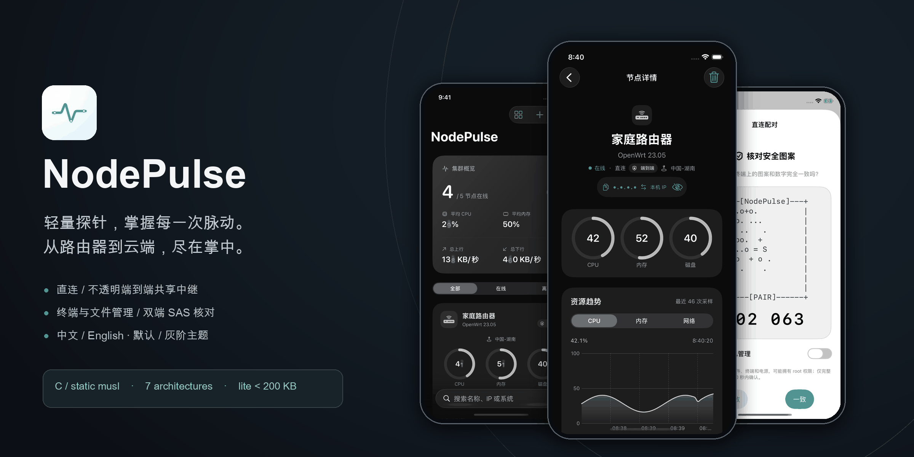
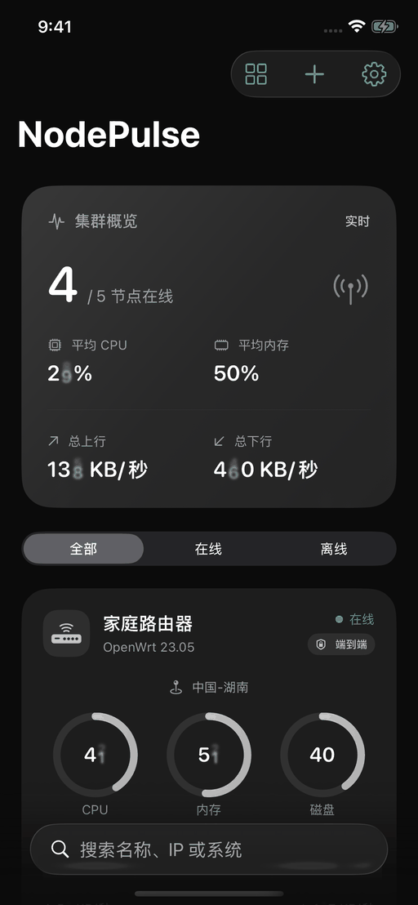
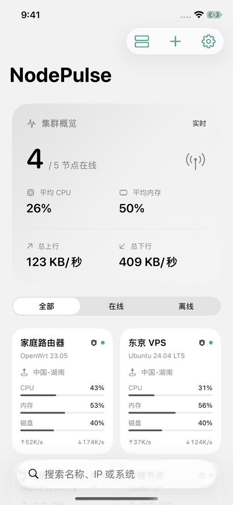
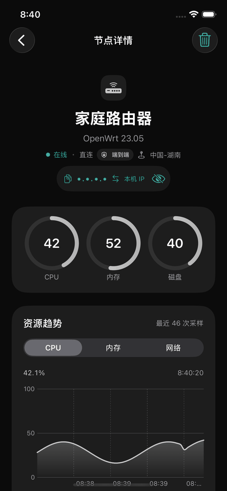
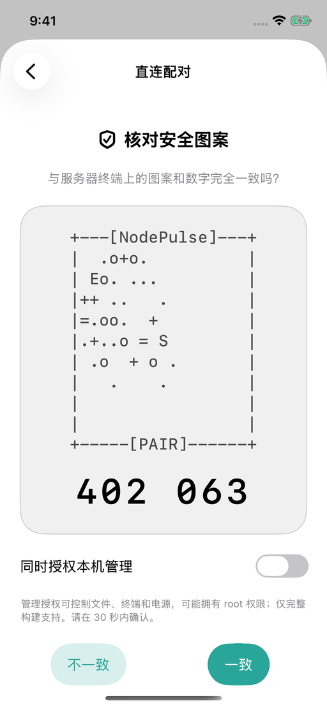
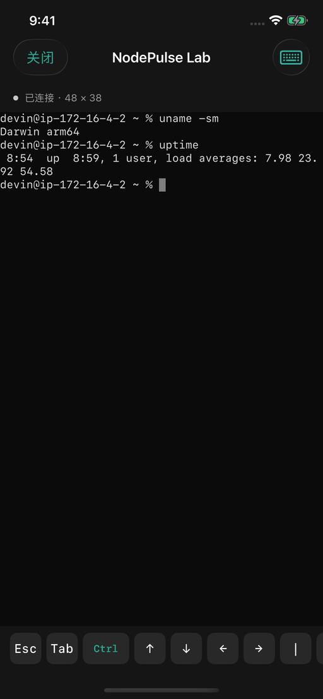
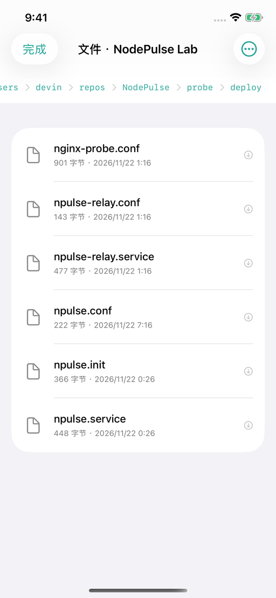
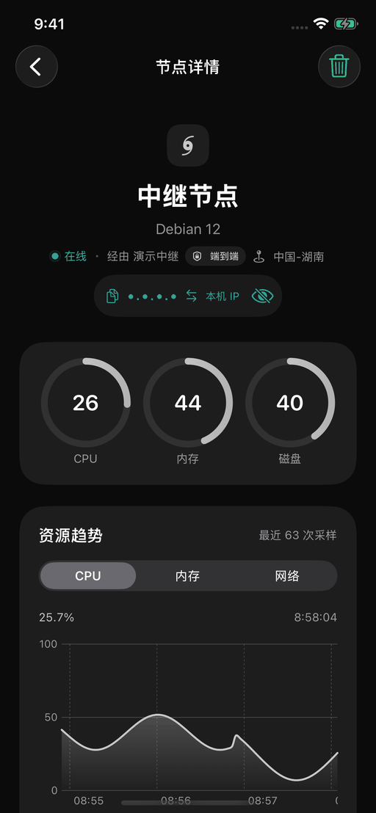
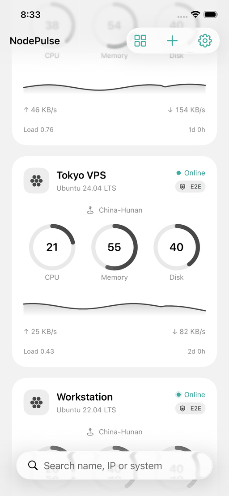
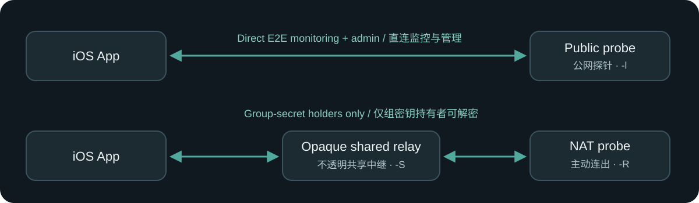

<div align="center">

**简体中文** · [English](README.en.md)


# NodePulse

**轻量探针，掌握每一次脉动。**

面向 Linux / OpenWrt 的微型 C 探针，与装进口袋的 iOS 监控及管理台。

[](ios/)
[](ios/)
[](probe/)
[](LICENSE)
[](https://github.com/cestbon0309/NodePulse/releases/latest)

[亮点](#features) · [界面](#screenshots) · [架构](#architecture) · [部署](#deploy) · [配对](#pairing) · [安装 App](#ios) · [构建](#build) · [安全](#security)



</div>

<a id="features"></a>
## 小体积，完整掌控

|  轻装部署 |  清晰观察 |  安全操作 |
|---|---|---|
| **纯 C / 静态 musl**：7 种 Linux 架构；所有发布 lite 小于 200,000 字节 | **实时资源趋势**：CPU、内存、磁盘、网络、温度与在线状态 | **远程管理**：交互终端、文件传输、重启 / 关机；独立管理公钥 |
| **一进程多角色**：直连与共享中继共存；systemd / OpenWrt procd | **双布局与双主题**：经典 / 紧凑，默认 / 灰阶，明暗模式 | **双端 SAS 核对**：直连、中继及扫码配对；二维码不绕过确认 |
| **NAT 友好**：节点只需主动连出；中继不持有组密钥 | **中英双语与位置**：跟随系统语言，出口 IP 位置持久缓存 | **隐私开关**：隐藏 IP 统一为 `•.•.•.•`，复制仍取真实地址 |

<a id="screenshots"></a>
## 界面一览

| 经典仪表盘 · 灰阶 | 紧凑仪表盘 |
|:---:|:---:|
|  |  |
| 节点详情 · 灰阶 | 双端 SAS 配对 |
|  |  |
| 终端 | 文件 |
|  |  |
| 共享中继节点 | 灰阶 · 浅色 |
|  |  |

仪表盘 / 详情为模拟器演示数据；配对、终端与文件画面来自本机隔离协议测试环境，非生产主机。示例位置不代表真实设备位置。

<a id="architecture"></a>
## 两条路径，同一掌控



直连适合公网设备；共享中继适合 NAT、家宽和路由器。组密钥只在可信组成员与 App 上，中继仅转发不透明密文。一个进程可同时 `-l` 监控与 `-S` 转发，本机管理走直连，下游管理走端到端中继管道。

<a id="deploy"></a>
## 快速部署

在 **Linux / OpenWrt 的 root shell** 执行。以下命令安装最新发行版；本文描述当前源码，新功能随下一版发行。

```sh
curl -fsSL https://github.com/cestbon0309/NodePulse/releases/latest/download/install.sh | sh
# 或
wget -qO- https://github.com/cestbon0309/NodePulse/releases/latest/download/install.sh | sh
```

首个问题是 `1 中文 / 2 English`，默认按 `LC_ALL` / `LANG` 选择；然后按网络环境选模式：

| 模式 | 适合谁 | 需要放行 |
|---|---|---|
| **1 直连**（公网推荐） | 公网服务器；可同时作共享中继 | 直连 TCP，默认 9000；启用中继时再开放其端口 |
| **2 HTTP + Nginx** | 已有域名、证书及 HTTPS 代理 | 公网 443；HTTP 后端仅回环 |
| **3 共享中继上报** | NAT / 家宽 / 路由器 | 仅向中继主动连出，无需入站 |
| **4 纯共享中继** | 只转发密文的公网主机 | 中继 TCP 端口 |

模式 1 的「同时作为共享中继？」默认 **no**；yes 后默认直连端口 + 1，端口必须不同。节点名默认主机名，可用 `--name` 修改。默认 **full**；体积优先时显式 `--lite`（无管理 / 管道，配对临时下载校验 full）。

```sh
# 已下载 install.sh：同一进程提供直连 9000 + 中继 9001
sh install.sh --yes --lang zh --mode 1 --public-ip auto --also-relay 9001
# NAT 下游：令牌与中继一致，同组使用相同高熵组密钥
NPULSE_TOKEN='替换为中继令牌' NPULSE_GROUP_SECRET='替换为随机组密钥' \
  sh install.sh --yes --lang zh --mode 3 --upstream relay.example:9001
```

摘要列出安装类型、配置、端口、中转地址 / 密码及下一步。**摘要含密钥，不要公开。** 本机防火墙与云安全组都须放行；自动执行防火墙变更须明确 `--open-firewall`。云公网地址不在本机网卡上也能配对，监听与广告地址分开保存。

完整选项、BusyBox 依赖、升级 / 卸载及授权见 [安装器参考](docs/installer.md)。旧式 `upstream=` / `u=` 已移除，升级会在改动服务前拒绝，并提示改用共享中继。

<a id="pairing"></a>
## 配对：扫码只是开始

1. 服务器运行 `sh install.sh pair`（自动停止 / 恢复服务），或安装末尾直接配对。
2. App **添加接入点**：公网节点选「直连配对」；NAT 节点选「中转配对」，填写中继地址、令牌与一次性代码。也可扫描终端二维码或粘贴 `nodepulse://pair` 链接。
3. **核对两端图案与六位数字（SAS）**。只有完全一致时，服务器输入 `y`，手机点「一致」。不一致立即取消；二维码和预共享参数不能替代确认。
4. 需要管理时，手机打开「同时授权本机管理」，服务器 **另外确认 root 授权**。未完成则只开监控。也可用 `--admin-via-pair`，或预置 `--admin-keys`。

二维码 / 链接含敏感临时参数，不要分享；中继配对走 TCP。详见 [配对协议](docs/pairing-protocol.md) 与 [管理协议](docs/admin-protocol.md)。

<a id="ios"></a>
## 安装 iOS App

从 [最新 Release](https://github.com/cestbon0309/NodePulse/releases/latest) 下载 `NodePulse-<tag>.ipa`，对照 `SHA256SUMS` 校验。这是 **未签名 arm64 真机包**，不是 App Store 包；需经 AltStore / Sideloadly 等自行签名，或用自己的 Xcode 开发者身份安装。要求 iOS 17+；按系统提示开启开发者模式并信任签名，有效期取决于 Apple 开发者账户。

<a id="build"></a>
## 从源码构建

```sh
cd probe
make CC=musl-gcc       # Linux 静态构建
./build.sh            # Zig：七架构 full + lite → dist/
make host-test        # macOS / Linux 协议测试，不是 macOS 监控
cd ../ios
xcodegen generate
open NodePulse.xcodeproj
./tools/build-unsigned-ipa.sh dev  # 未签名真机 Release IPA
```

需要 C / musl 工具链，交叉编译需 Zig；iOS 需 macOS、Xcode 与 XcodeGen。架构：`x86_64`、`i386`、`aarch64`、`armv7`（硬浮点）、`armv7-soft`、`mips`、`mipsel`（注意字节序 / ABI）。Xcode 选模拟器运行单元测试；`ios/tools/check-localization.py` 审计双语覆盖。探针回归：`python3 probe/tools/test-probe.py probe/npulse-host`（需 Python cryptography）。

<a id="security"></a>
## 安全模型与边界

- **默认仅监控**：管理须独立 Ed25519 allowlist，权限等同探针用户。安装器启用管理后改为 root，拥有整机控制权；普通 systemd 使用 DynamicUser，procd 使用 root。
- **直连 / 共享 TCP**：ChaCha20-Poly1305；管理用临时 X25519 握手与独立方向密钥。监控 / 组协议无前向保密和口令拉伸，务必用随机长密钥。
- **中继不可信**：可见路由元数据、大小和时序，可拒绝服务 / 重放；客户端验证签名、槽位与快照时间。同组成员互信，令牌不能代替组密钥。
- **HTTPS 接入点**：TLS 在 Nginx 终止，不显示 TCP 的 E2E 徽章，也不支持管理；HTTP 后端不可公开暴露。共享组负载仍有独立端到端加密。
- **位置不是安全凭据**：full 探针以小型明文 HTTP 请求发现出口 IP，可配置或关闭；App 经 HTTPS 查询第三方位置并按 IP / 语言缓存，该服务会收到查询 IP。失败不影响监控；隐藏 IP 不隐藏位置。详见 [出口发现与位置](docs/egress-location.md)。

## 许可证

**GPL-2.0-only**，见 [LICENSE](LICENSE)。Monocypher（BSD-2-Clause / CC0）、Nayuki QR（MIT）及 SwiftTerm（MIT）保留各自声明，见 [第三方许可证](ios/NodePulse/ThirdPartyNotices.txt)；App 设置内亦可查看。
